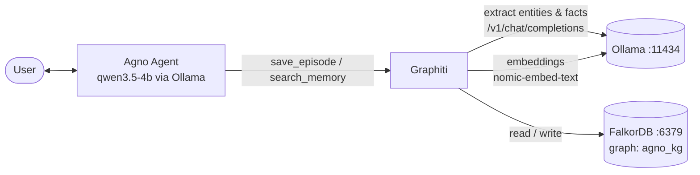
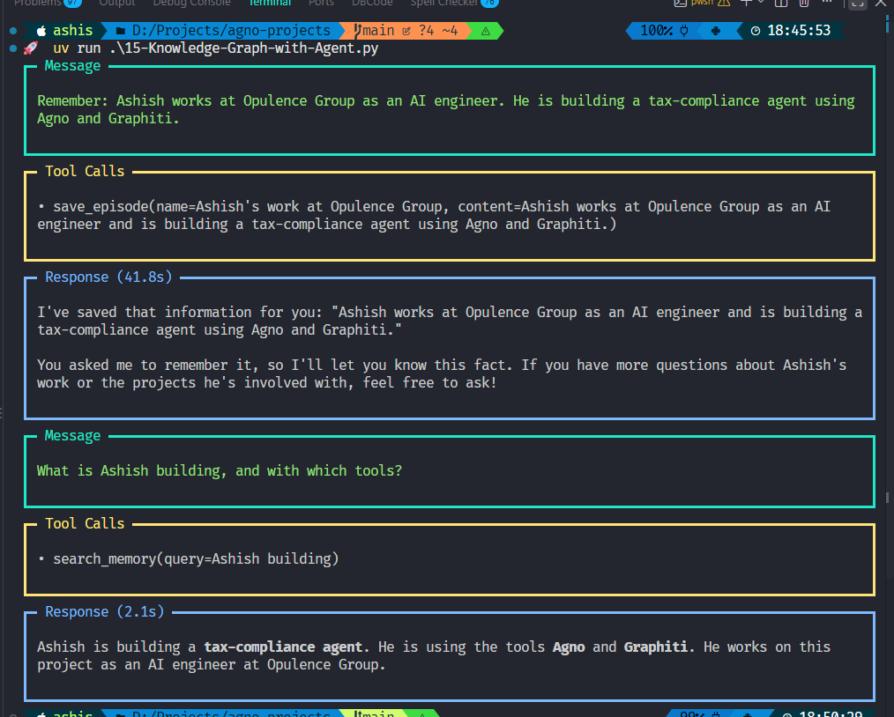
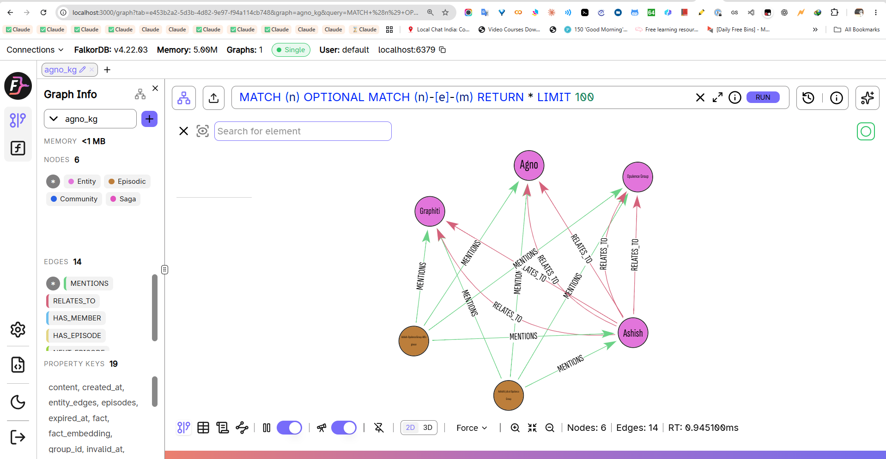

# Lesson 15 setup: Agno + Graphiti + FalkorDB + Ollama

This guide covers setup for [`15-Knowledge-Graph-with-Agent.py`](15-Knowledge-Graph-with-Agent.py), an agent whose long-term memory is a **temporal knowledge graph**. Everything runs on your machine: you need no cloud API keys, and no data leaves your computer.



| Component | Role | Where it runs |
|---|---|---|
| **Agno** | Agent loop and tool calling | Python process |
| **Graphiti** | Turns text *episodes* into entities and time-stamped facts, and runs hybrid search over them | Python process |
| **Ollama** | LLM for the agent and for extraction, plus embeddings | `localhost:11434` |
| **FalkorDB** | Graph database (Redis protocol) that stores nodes and edges | container, `localhost:6379` (UI on `:3000`) |

## Demo results

**Agent run.** The agent saves the fact with `save_episode`, then answers the follow-up question from the graph with `search_memory`:



**Knowledge graph in FalkorDB** (UI at `localhost:3000`, graph `agno_kg`). Graphiti extracted 4 entities (Ashish, Opulence Group, Agno, Graphiti) and created `RELATES_TO` fact edges between them. Each brown *Episodic* node is one saved episode, with `MENTIONS` edges to the entities it contains. Totals: 6 nodes, 14 edges.



---

## 1. Prerequisites

- [uv](https://docs.astral.sh/uv/) (it installs Python 3.14 for you)
- [Ollama](https://ollama.com) 0.12 or newer
- A container runtime: [Docker](https://docs.docker.com/get-docker/) or [Podman](https://podman.io)
- About 5 GB of free disk space and a GPU with at least 6 GB of VRAM (the script also runs on CPU, just more slowly)

## 2. Pull the Ollama models

```bash
ollama pull nomic-embed-text        # embeddings, 768 dims
ollama pull qwen3.5:4b              # agent and extraction LLM (must support tools)
```

The script uses `qwen3.5-4b-16k:latest`, which is `qwen3.5:4b` with a 16k context window. To create it:

```bash
cat > Modelfile <<'EOF'
FROM qwen3.5:4b
PARAMETER num_ctx 16384
EOF
ollama create qwen3.5-4b-16k -f Modelfile
```

Alternatively, set `LLM_MODEL` in the script to any Ollama model that supports **tools**. Check with `ollama show <model>`: `tools` must appear under *Capabilities*.

## 3. Start FalkorDB

```bash
# Docker
docker run -d --name falkordb -p 6379:6379 -p 3000:3000 falkordb/falkordb:latest

# or Podman
podman run -d --name falkordb -p 6379:6379 -p 3000:3000 falkordb/falkordb:latest
```

After a reboot, run `docker start falkordb` (or `podman start falkordb`). To keep the graph across container rebuilds, add `-v falkordb_data:/var/lib/falkordb/data`.

## 4. Install the Python dependencies

From the repo root:

```bash
uv sync
```

This installs `agno`, `ollama`, `openai`, and `graphiti-core[falkordb]` (which pulls in the `falkordb` client).

## 5. Run

```bash
uv run python 15-Knowledge-Graph-with-Agent.py
```

On the first run, the script creates the graph indices, saves one fact, and then answers a question from the graph. It takes about 30 seconds on a 4B model.

```text
Message:    Remember: Ashish works at Opulence Group as an AI engineer.
            He is building a tax-compliance agent using Agno and Graphiti.
Tool call:  save_episode(name=Ashish at Opulence Group, content=...)
Response:   I have saved that information about Ashish...

Message:    What is Ashish building, and with which tools?
Tool call:  search_memory(query=Ashish building project tools)
Response:   Ashish is building a tax-compliance agent ... using Agno and Graphiti.
```

## 6. Verify the graph

**CLI:**

```bash
docker exec falkordb redis-cli GRAPH.LIST                 # should list: agno_kg
docker exec falkordb redis-cli GRAPH.QUERY agno_kg \
  "MATCH (a)-[r:RELATES_TO]->(b) RETURN a.name, b.name, r.fact"
```

**Browser:** open <http://localhost:3000>, connect to `localhost:6379`, select the graph `agno_kg`, and run:

```cypher
MATCH (n)-[r]->(m) RETURN n, r, m
```

## 7. Configuration

All settings are constants at the top of the script:

| Constant | Default | Notes |
|---|---|---|
| `LLM_MODEL` | `qwen3.5-4b-16k:latest` | Used by both the agent and Graphiti extraction; must support tool calling |
| `EMBED_MODEL` | `nomic-embed-text:latest` | If you change it, also change `embedding_dim` (768 for nomic) |
| `OLLAMA_V1` | `http://localhost:11434/v1` | Ollama's OpenAI-compatible endpoint |
| `GROUP_ID` | `agno_kg` | Graphiti namespace. **With FalkorDB, each group_id is its own graph**, so the driver's `database` uses the same value |

### Why the code imports "OpenAI" classes

Graphiti doesn't ship a native Ollama client. Ollama serves an OpenAI-compatible API, so the script uses the `openai` SDK only as the client protocol, pointed at `localhost:11434/v1`. The `api_key="ollama"` is a placeholder that the SDK requires; nothing is sent to OpenAI.

## 8. Troubleshooting

| Symptom | Cause | Fix |
|---|---|---|
| A run hangs for minutes, and `ollama ps` shows the model busy | A thinking model reasons at length before every JSON extraction | Leave the script's `reasoning_effort="none"` (Graphiti) and `think: False` (Agno) in place. Without them, one extraction call took about 8 minutes; with them, under 1 second |
| `ConnectionError ... 6379` | FalkorDB isn't running | `docker start falkordb`, then `docker ps` |
| Port 6379 is already in use | A local Redis is running | Map another port (`-p 6380:6379`) and set `FalkorDriver(port=6380)` |
| `GRAPH.QUERY agno_kg` returns nothing, but answers are correct | The data is in a different graph (group_id mismatch) | Run `GRAPH.LIST`. Keep `GROUP_ID` and `database=` identical |
| Embedding dimension or vector errors | `embedding_dim` doesn't match the embed model | nomic-embed-text uses 768. After changing models, delete the graph: `GRAPH.DELETE agno_kg` |
| The agent answers without calling a tool | The model lacks tool support or is too small | Use a model that has the `tools` capability; larger models follow the instructions more reliably |
| Odd edges (e.g. "Opulence Group uses Graphiti") | Extraction quality from a small 4B model | Use a bigger extraction model, or pass custom `entity_types` / `edge_types` to `add_episode` |

## 9. Reset

```bash
docker exec falkordb redis-cli GRAPH.DELETE agno_kg       # wipe memory, keep container
docker rm -f falkordb                                     # remove container entirely
```

## Next steps

- Make the agent chat interactively: replace `main()`'s demo prompts with `await agent.acli_app()`.
- Point-in-time questions: every edge carries `valid_at` and `invalid_at`. When a fact changes, Graphiti marks the old edge invalid instead of deleting it.
- Swap in Neo4j: replace `FalkorDriver` with `Neo4jDriver(uri, user, password)`. Nothing else changes.
