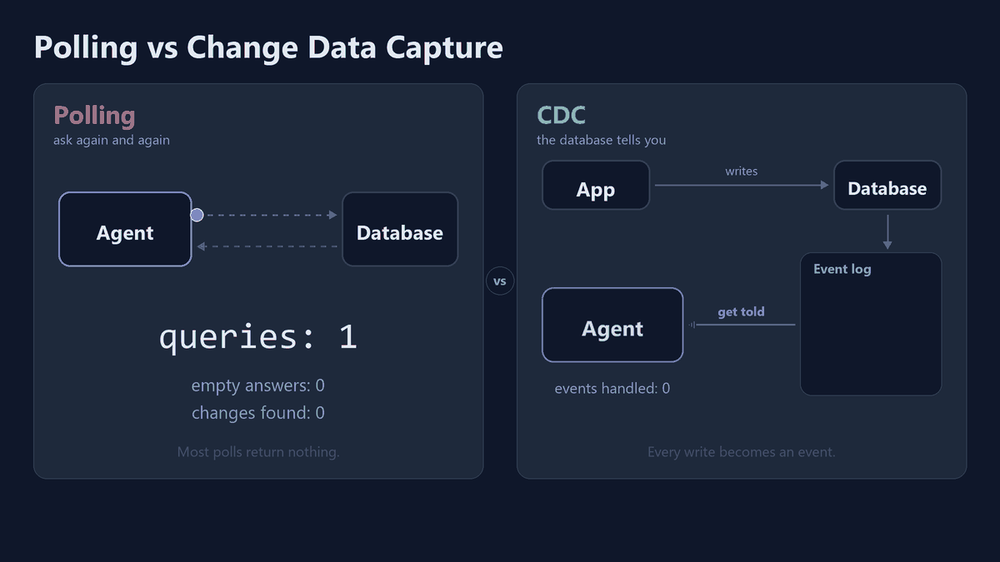
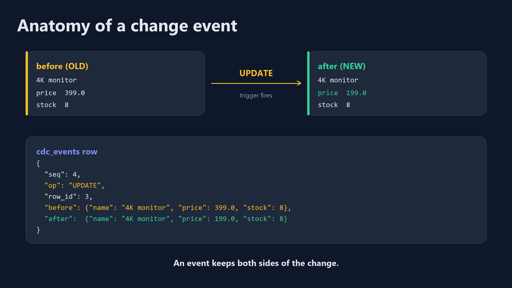
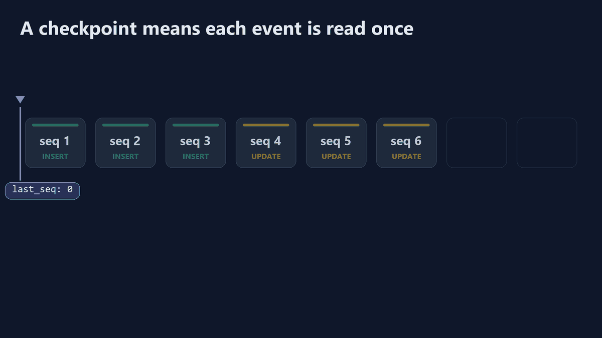
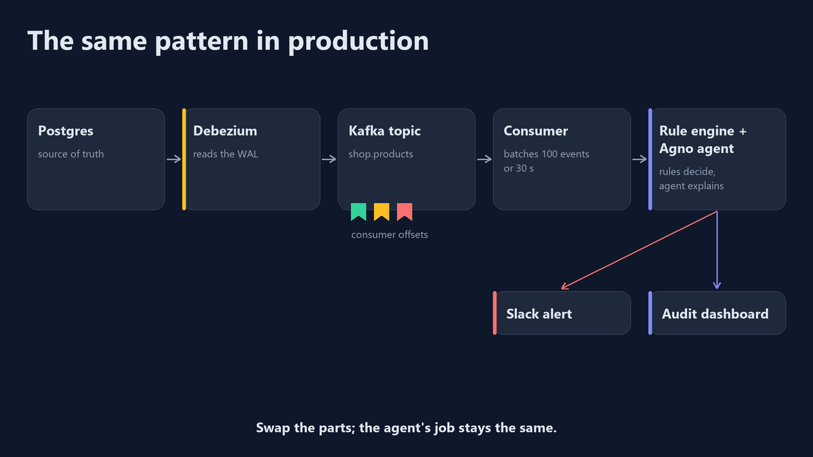

# Stop Asking Your Database "What's New?": Change Data Capture for AI Agents

*How to build an agent that hears about every INSERT, UPDATE and DELETE the moment it happens, using SQLite triggers and a small Python script, with nothing sent to the cloud.*



---

Most AI agents look at data the way a tourist reads a map: they see where things are *now*. Ask "what's the price of the 4K monitor?" and the agent runs a query and tells you $199.

But the questions that matter in operations are about *change*:

- Who cut the monitor's price in half, and when?
- Which product just went out of stock?
- Did someone delete a live product?

A snapshot can't answer those. By the time you look, the old value is gone.

This is the problem **Change Data Capture (CDC)** solves. In this post we'll build an agent that consumes a database's change stream, flags risky changes, and explains them in plain English. It runs fully local with [Agno](https://github.com/agno-agi/agno), SQLite and a 4B model on Ollama.

The full code is lesson 16 in my [Agent-harness-using-Agno](https://github.com/ashishpatel26/Agent-harness-using-Agno) repo: [`16-Change-Data-Capture-with-Agent.py`](16-Change-Data-Capture-with-Agent.py).

---

## Step 1: What CDC actually is

Change Data Capture means **recording every change to a table as an event**. Each event says:

| Field | Meaning |
|---|---|
| `op` | `INSERT`, `UPDATE` or `DELETE` |
| `row_id` | which row changed |
| `before` | the row before the change (empty for an insert) |
| `after` | the row after the change (empty for a delete) |
| `seq` | an increasing sequence number, so events have an order |

That's the whole idea. Instead of a table that only knows its present, you get a log of everything that happened to it.

You may know the industrial version: [Debezium](https://debezium.io) reads the Postgres write-ahead log or the MySQL binlog and publishes events to Kafka. Same concept, bigger plumbing. We'll do it in about 30 lines of SQL.



### Why not just poll?

The obvious alternative is polling: every minute, ask "anything new?". It has three problems:

1. **It's wasteful.** Most polls return nothing.
2. **It misses things.** If a price goes 399 → 199 → 399 between two polls, you never see the cut.
3. **It loses the "before".** A poll sees the current row. It can't tell you what the value *was*.

CDC turns this around. You don't ask what's new; you get told.

---

## Step 2: Capture changes with database triggers

There are three common ways to capture changes:

| Approach | How | Trade-off |
|---|---|---|
| **Log-based** | Read the database's transaction log (Debezium) | Best for production, needs extra infrastructure |
| **Trigger-based** | A trigger writes each change into an events table | Simple and self-contained, adds a little write cost |
| **Timestamp-based** | Query `WHERE updated_at > last_run` | Misses deletes, can't see "before" values |

For a learning example, triggers win: no extra services, and the app code doesn't change at all. Here's the source table and the events table:

```sql
CREATE TABLE products (
    id    INTEGER PRIMARY KEY,
    name  TEXT NOT NULL,
    price REAL NOT NULL,
    stock INTEGER NOT NULL
);

CREATE TABLE cdc_events (
    seq        INTEGER PRIMARY KEY AUTOINCREMENT,
    table_name TEXT NOT NULL,
    op         TEXT NOT NULL CHECK (op IN ('INSERT', 'UPDATE', 'DELETE')),
    row_id     INTEGER NOT NULL,
    before     TEXT,
    after      TEXT,
    changed_at TEXT NOT NULL DEFAULT (datetime('now'))
);
```

And one trigger per operation. The `UPDATE` trigger is the interesting one, because it stores both `OLD` and `NEW`:

```sql
CREATE TRIGGER products_update AFTER UPDATE ON products BEGIN
    INSERT INTO cdc_events (table_name, op, row_id, before, after)
    VALUES ('products', 'UPDATE', NEW.id,
            json_object('name', OLD.name, 'price', OLD.price, 'stock', OLD.stock),
            json_object('name', NEW.name, 'price', NEW.price, 'stock', NEW.stock));
END;
```

The `INSERT` trigger only fills `after`, and the `DELETE` trigger only fills `before`. SQLite's built-in `json_object` packs each row into JSON, so the events table works for any schema.


The key point: **the application never knows CDC exists.** It runs ordinary `UPDATE products SET price = 199 WHERE id = 3`, and the database records the change by itself.

---

## Step 3: Read the stream with a checkpoint

An event log is only useful if the consumer knows where it left off. That bookmark is called a **checkpoint** (Kafka calls it an *offset*).

Our checkpoint is a single number, `last_seq`, kept in the agent's `session_state`. Agno persists session state to SQLite between runs, so the agent remembers its place even after a restart.

```python
def fetch_changes(run_context: RunContext, limit: int = 20) -> str:
    """Read change events newer than the checkpoint and advance the checkpoint."""
    last_seq = run_context.session_state.get("last_seq", 0)
    with connect() as conn:
        rows = conn.execute(
            "SELECT * FROM cdc_events WHERE seq > ? ORDER BY seq LIMIT ?", (last_seq, limit)
        ).fetchall()
    ...
    if events:
        run_context.session_state["last_seq"] = events[-1]["seq"]
```

`WHERE seq > last_seq ORDER BY seq` is the whole consumer. Each call returns only events the agent hasn't seen, in the order they happened.



> **A note on delivery guarantees.** This code moves the checkpoint as soon as it *reads* the events. If the agent crashed before finishing its summary, those events would be skipped: that's **at-most-once** delivery. For **at-least-once**, move the checkpoint only after the agent has finished processing. For a demo the simple version is fine; in production, choose on purpose.

---

## Step 4: Let code decide, let the agent explain

Here's the design decision I care most about. The agent should **not** decide what counts as risky. A 4B model will sometimes miss a 50% price cut or invent one. So the risk rules are plain Python:

```python
PRICE_DROP_ALERT = 0.30  # flag price cuts of 30% or more

def flag(op: str, before: dict | None, after: dict | None) -> list[str]:
    """Deterministic risk rules. The agent explains these, it doesn't invent them."""
    flags = []
    if op == "DELETE":
        flags.append("product deleted")
    if before and after:
        if after["price"] < before["price"] * (1 - PRICE_DROP_ALERT):
            cut = 1 - after["price"] / before["price"]
            flags.append(f"price cut {cut:.0%}")
        if before["stock"] > 0 and after["stock"] == 0:
            flags.append("went out of stock")
    return flags
```

`fetch_changes` attaches these flags to each event and also returns a ready-made `needs_attention` list. The agent's job is the part language models are good at: turning raw JSON into a short, readable report.


I learned this the hard way. In my first version the agent received only the raw events. It summarised them correctly, then wrote "no events have been flagged", while the 50% price cut sat right there in its own output. Handing it a separate `needs_attention` list fixed that for good.

**Rules decide. The agent explains.**

---

## Step 5: Wire up the agent

With the tools in place, the agent itself is short:

```python
agent = Agent(
    name="CDC Watcher",
    model=Ollama(id="qwen3.5-4b-16k:latest", request_params={"think": False}),
    db=SqliteDb(id="cdc-db", db_file="db/cdc.db"),
    session_state={"last_seq": 0},
    tools=[fetch_changes, get_row_history, reset_checkpoint],
    instructions=[
        "You watch the change stream of the shop's products table.",
        "To process changes, call fetch_changes once, then summarise what changed per product.",
        "Start with a 'Needs attention' section listing every item in needs_attention ...",
        "Never invent changes; if no events are returned, say nothing changed.",
        "Current checkpoint: last processed seq = {last_seq}",
    ],
    markdown=True,
)
```

Three tools, three jobs:

| Tool | What it does |
|---|---|
| `fetch_changes` | Reads new events since the checkpoint, attaches flags, moves the checkpoint |
| `get_row_history` | Returns every event for one product: its full timeline |
| `reset_checkpoint` | Rewinds the checkpoint to replay events |

Two details worth copying:

- `{last_seq}` in the instructions is filled from session state, so the agent always knows where it is.
- `think: False` turns off the model's thinking mode. On a local 4B model that's the difference between waiting minutes and waiting seconds.


---

## Step 6: Run it

The demo plays both sides: it acts as the application writing to the shop, then lets the agent process the changes.

```python
# The "application" writes; the triggers capture every change
conn.executemany("INSERT INTO products ...", [
    (1, "Mechanical keyboard", 120.0, 40),
    (2, "USB-C hub", 45.0, 15),
    (3, "4K monitor", 399.0, 8),
])
conn.execute("UPDATE products SET price = 199.0 WHERE id = 3")  # 50% cut
conn.execute("UPDATE products SET stock = 0 WHERE id = 2")
conn.execute("UPDATE products SET price = 115.0 WHERE id = 1")  # small change, no flag

agent.print_response("Process new changes and flag anything risky.", session_id=session_id)
```

```bash
uv run python 16-Change-Data-Capture-with-Agent.py
```

This is the real output from my machine (shortened slightly).

**Run 1: six events (seq 1 to 6)**

```text
Tool call:  fetch_changes(limit=100)

Needs Attention
 • Product ID: 3 (4K monitor) - Flag: price cut 50%
 • Product ID: 2 (USB-C hub) - Flag: went out of stock

Details
 • 4K Monitor: Price reduced from $399.00 to $199.00
 • USB-C Hub: Stock depleted from 15 to 0 units
```

The $120 → $115 keyboard change is a 4% cut, so it correctly stays out of the alert list.

**Then more writes arrive:** the USB-C hub is deleted and the monitor is restocked.

**Run 2: only the two new events (seq 7 and 8)**

```text
Tool call:  fetch_changes(limit=50)

Needs attention
 • Product ID: 2 (USB-C hub) - Product deleted

Summary of changes
 • Seq 7: USB-C hub (row_id 2) has been deleted.
 • Seq 8: 4K monitor (row_id 3) was updated, increasing stock from 8 to 12
   items at the same price ($199.0). No flags were associated with this update.
```

Notice it didn't re-report the price cut. The checkpoint did its job.

**Run 3: "What happened to product 3 over time?"**

```text
Tool call:  get_row_history(product_id=3)

 • It was initially inserted with a price of $399.00 (seq: 3).
 • Its price was updated down to $199.00 (seq: 4).
 • Its stock quantity increased from 8 to 12 (seq: 8), while the price
   remained at $199.00.

Checkpoint: {'last_seq': 8}
```

This is the question a snapshot can never answer. The current row says "$199, stock 12". Only the change log knows it used to be $399.


---

## Step 7: Taking it to production

The pattern stays the same as you scale up; only the parts get bigger:

| Demo | Production |
|---|---|
| SQLite triggers | Debezium reading the Postgres WAL or MySQL binlog |
| `cdc_events` table | A Kafka or Redpanda topic |
| `last_seq` in session state | Consumer-group offsets |
| `WHERE seq > ?` loop | A consumer that wakes the agent per batch |
| Checkpoint moved on read | Checkpoint committed after processing (at-least-once) |
| 3 Python rules | A rule engine or anomaly model; the LLM still only explains |

A few things to plan for:

- **Batching.** Don't call an LLM per event. Collect a window (say 100 events or 30 seconds) and summarise once.
- **Idempotency.** With at-least-once delivery the agent may see an event twice. Key alerts by `seq` so a replay doesn't double-notify.
- **Retention.** An append-only log grows forever. Archive or compact old events.
- **Schema changes.** If you add a column, update the trigger's `json_object`, or the new field won't appear in events.



---

## Recap

1. **CDC records changes, not just state.** Every event keeps `op`, `before`, `after` and an order.
2. **Triggers are the simplest capture method.** The app code doesn't change.
3. **A checkpoint makes the stream consumable.** One number, `last_seq`, kept in the agent's session state.
4. **Code decides what's risky; the agent explains it.** That keeps a small model reliable.
5. **The same design scales.** Swap triggers for Debezium and the table for Kafka; the agent's job stays the same.

The full script is about 230 lines, and most of it is the SQL schema and comments. Clone the repo, run lesson 16, then try changing a price yourself and asking the agent what happened.
