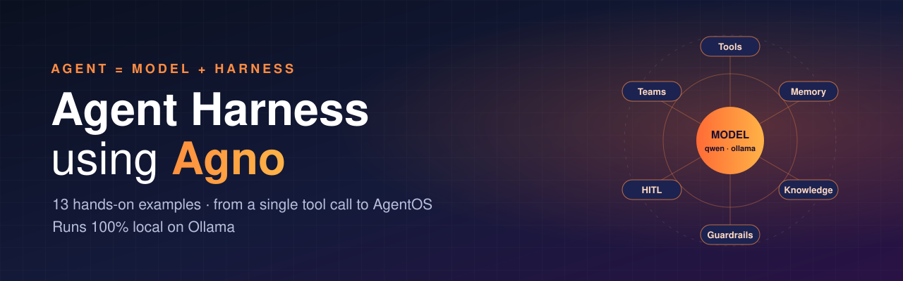
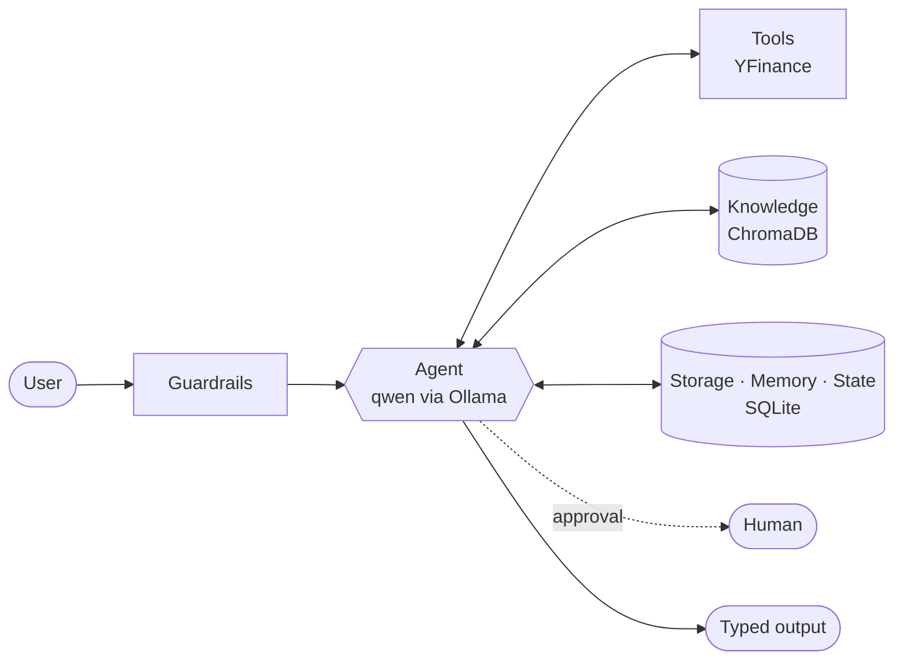

<p align="center">
  
</p>

<p align="center">
  
  
  
  
  
</p>

<p align="center">
  <b>A step-by-step tour of building AI agents with <a href="https://github.com/agno-agi/agno">Agno</a>.</b><br>
  Each script adds one harness capability on top of the last. Every example runs on a local model, with no API keys needed.
</p>

---

## Why "harness"?

A model on its own only predicts text. The **harness** is everything around it that turns it into an agent: tools, schemas, storage, memory, state, knowledge, guardrails, human approval, and coordination with other agents. This repo builds that harness one layer at a time.



## Examples

| # | Script | Capability | What you learn |
|---|--------|-----------|----------------|
| 1 | [`1-Agent-with-tools.py`](1-Agent-with-tools.py) | **Tools** | Give an agent live market data through `YFinanceTools` |
| 2 | [`2-Agent-with-structured-output.py`](2-Agent-with-structured-output.py) | **Structured output** | Return a Pydantic `StockAnalysis` instead of free text |
| 3 | [`3-Agent-with-typed-input-output.py`](3-Agent-with-typed-input-output.py) | **Typed I/O** | Validate the request *and* the response with schemas |
| 4 | [`4-Agent-with-storage.py`](4-Agent-with-storage.py) | **Storage** | Persist chat history in SQLite and resume a session across runs |
| 5 | [`5-Agent-with-memory.py`](5-Agent-with-memory.py) | **Memory** | Remember user preferences across *all* conversations |
| 6 | [`6-Agent-with-state-management.py`](6-Agent-with-state-management.py) | **State** | Keep a watchlist the agent reads and edits through tools |
| 7 | [`7-Agent-search-over-knowledge.py`](7-Agent-search-over-knowledge.py) | **Knowledge / RAG** | Hybrid search over ChromaDB with `nomic-embed-text` embeddings |
| 8 | [`8-Agent-with-learning.py`](8-Agent-with-learning.py) | **Learning** | Store reusable insights that help future users and sessions |
| 9 | [`9-Agent-with-guardrails.py`](9-Agent-with-guardrails.py) | **Guardrails** | Block PII and prompt injection, and write a custom guardrail |
| 10 | [`10-Agent-Human-in-loop.py`](10-Agent-Human-in-loop.py) | **Human-in-the-loop** | Pause before a sensitive tool call and approve or reject it |
| 11 | [`11-Multi-Agent-team.py`](11-Multi-Agent-team.py) | **Teams** | Bull vs. bear analysts, with a lead that writes the verdict |
| 12 | [`12-Multi-Agent-Sequencial-Workflow.py`](12-Multi-Agent-Sequencial-Workflow.py) | **Workflows** | A step-by-step research pipeline with explicit data flow |
| 13 | [`13-Agentos-AGUI.py`](13-Agentos-AGUI.py) | **AgentOS + AG-UI** | Serve an agent as an API with a chat UI protocol |
| 14 | [`14-AgentUI.py`](14-AgentUI.py) | **AgentOS multi-agent** | Serve web and finance agents for Agent UI / os.agno.com |
| 15 | [`15-Knowledge-Graph-with-Agent.py`](15-Knowledge-Graph-with-Agent.py) | **Knowledge graph memory** | Agno + Graphiti + FalkorDB + Ollama: fully local temporal knowledge graph |

### Lesson 15: Agno + Graphiti + FalkorDB + Ollama

**Full setup guide:** [`15-Knowledge-Graph-with-Agent.md`](15-Knowledge-Graph-with-Agent.md)

The agent stores facts as Graphiti *episodes*. Graphiti pulls out entities and relationships with a local Ollama model, embeds them with `nomic-embed-text`, and writes them to FalkorDB. Answers then come from a hybrid graph search. Nothing leaves your machine. Graphiti reaches Ollama through its OpenAI-compatible `/v1` endpoint, so no OpenAI key is needed.

```bash
podman run -d --name falkordb -p 6379:6379 -p 3000:3000 falkordb/falkordb   # or docker; graph UI at http://localhost:3000
ollama pull nomic-embed-text
uv run python 15-Knowledge-Graph-with-Agent.py
```

Sample output (about 30 s end to end on a 4B model):

```text
Message:    Remember: Ashish works at Opulence Group as an AI engineer.
            He is building a tax-compliance agent using Agno and Graphiti.
Tool call:  save_episode(name=Ashish at Opulence Group, content=...)
Response:   I have saved that information about Ashish...

Message:    What is Ashish building, and with which tools?
Tool call:  search_memory(query=Ashish building project tools)
Response:   Ashish is building a tax-compliance agent. He is working on this project at
            Opulence Group as an AI engineer and is using Agno and Graphiti as the main tools.
```

Edges stored in FalkorDB (graph `agno_kg`):

| From | To | Fact |
|---|---|---|
| Ashish | Opulence Group | Ashish works at Opulence Group as an AI engineer building a tax-compliance agent using Agno and Graphiti |
| Ashish | Agno | Ashish is building a tax-compliance agent using Agno |
| Ashish | Graphiti | Ashish is building a tax-compliance agent using Graphiti |

> Qwen3.5 is a thinking model. The script turns thinking off (`reasoning_effort="none"` for Graphiti, `think: False` for Agno); with thinking on, each extraction call took about 8 minutes.

## Capstone project: Tax Compliance A2A

[**`tax-compliance-a2a/`**](tax-compliance-a2a/) puts all 14 lessons into one system: a "have your agent call our agent" tax compliance network. An orchestrator team routes to five specialist agents, every number comes from a deterministic tax engine, filing needs human approval, and the whole network is served over **A2A** and **MCP** so other agents can call it.

### Storage vs. memory vs. state vs. learning

| | Scope | Holds | Example |
|---|---|---|---|
| **Storage** | one session | the conversation history | "Compare *that* to Tesla" |
| **Memory** | one user | facts about the user | "I prefer dividend stocks" |
| **State** | one session | structured data the agent edits | `watchlist = ["NVDA", "AMD"]` |
| **Learning** | all users | general lessons | "Check debt ratios for utilities" |

## Quick start

**1. Requirements:** [uv](https://docs.astral.sh/uv/), [Ollama](https://ollama.com), and Python 3.14 (uv installs it for you).

**2. Pull the models**

```bash
ollama pull qwen3.5:4b          # chat model
ollama pull nomic-embed-text    # embeddings for examples 7 and 8
```

The scripts use the tag `qwen3.5-4b-16k`, which is qwen with a 16k context window. Create it once:

```bash
printf 'FROM qwen3.5:4b\nPARAMETER num_ctx 16384\n' > Modelfile
ollama create qwen3.5-4b-16k -f Modelfile
```

> Using a different model? Change `Ollama(id="...")` in the scripts.

**3. Install and run**

```bash
git clone https://github.com/ashishpatel26/Agent-harness-using-Agno.git
cd Agent-harness-using-Agno
uv sync
uv run 1-Agent-with-tools.py
```

Run the examples in order: each one builds on the ideas of the previous script.

## Project layout

```
.
├── 1-…13-*.py          # the examples, in learning order
├── data/               # source documents for the knowledge base
├── db/                 # SQLite + ChromaDB files (created at runtime, git-ignored)
├── assets/banner.svg
└── pyproject.toml
```

## Tech stack

**[Agno](https://github.com/agno-agi/agno)** (agents, teams, workflows, AgentOS) · **[Ollama](https://ollama.com)** (local LLM and embeddings) · **[ChromaDB](https://www.trychroma.com)** (vector store) · **SQLite** (sessions, memory, state) · **[yfinance](https://github.com/ranaroussi/yfinance)** (market data) · **Pydantic** · **FastAPI**

## Disclaimer

The finance examples are for learning only. They are **not investment advice**, and market data from Yahoo Finance can be delayed or incomplete.

---

<p align="center">If this helped you learn agent engineering, consider giving it a ⭐</p>
