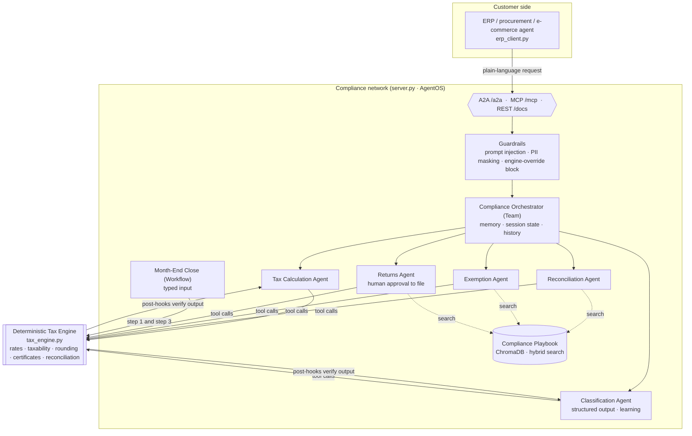

# Tax Compliance A2A: "Have Your Agent Call Our Agent"

A multi-agent tax compliance network built with [Agno](https://github.com/agno-agi/agno). It uses every pattern from examples 1–14 in this repo.

External business agents (an ERP, procurement or e-commerce AI) don't integrate tax APIs. They send a plain-language request to one **orchestrator agent** over **A2A** or **MCP**. The orchestrator delegates to specialist agents, and every number comes from a **deterministic tax engine**, never from the model.

> This independent educational demo is inspired by the agent-to-agent compliance pattern that Avalara describes publicly. It is not affiliated with or endorsed by Avalara. All rates, codes, customers and certificates are simplified **demo data**: do not use them for real tax decisions.

## Architecture



**The core rule:** the AI handles orchestration, extraction and explanation, and the engine produces the numbers.
- Agents reach tax data **only through tools** that call `tax_engine.py`.
- A **post-hook** blocks any Tax Calculation answer that didn't call the engine ("no tool call, no number").
- A **post-hook** blocks any classification that uses a tax code or SKU missing from the engine's catalog.
- A **guardrail** rejects requests like "override the rate to 2%" before the model sees them.
- In the workflow, the go/no-go filing table is built by code. The model only adds commentary.

## The agents

| Agent | Job | Uses |
|---|---|---|
| **Compliance Orchestrator** (Team) | Single entry point. Routes and chains specialists | Guardrails, memory, session state, history |
| **Tax Calculation Agent** | Real-time tax on an order, jurisdiction sourcing | Engine tools, `require_engine_call` post-hook |
| **Classification Agent** | Unstructured product text → catalog tax code | `output_schema`, learning, `require_catalog_codes` post-hook |
| **Reconciliation Agent** | ERP vs. tax log discrepancies, with fixes | Writes `open_discrepancies` to session state, playbook RAG |
| **Exemption Agent** | Certificate validity and what it means | Engine certificate check, playbook RAG |
| **Returns Agent** | Filing readiness and submission | `@tool(requires_confirmation=True)`, playbook RAG |
| **Month-End Close** (Workflow) | Engine reconcile → AI explains → engine readiness memo | `input_schema=CloseRequest`, function steps |

## Every repo concept, applied

| Repo example | Where it shows up here |
|---|---|
| 1 · Tools | `calculate_sales_tax`, `validate_exemption_certificate`, `run_reconciliation`, … |
| 2 · Structured output | `ClassificationResult` on the Classification Agent |
| 3 · Typed input/output | `CloseRequest` input schema on the workflow |
| 4 · Storage | Every agent, the team and the workflow persist to `db/compliance.db` |
| 5 · Memory | The orchestrator remembers each customer's states, filing frequency and ERP |
| 6 · State | `filing_period`, `open_discrepancies` and `filed_returns` in team session state |
| 7 · Knowledge | `data/tax_rules.md` playbook, hybrid search with `nomic-embed-text` |
| 8 · Learning | The Classification Agent saves reusable rules ("license keys by email are DIG-DL") |
| 9 · Guardrails | `PromptInjectionGuardrail`, `PIIDetectionGuardrail(mask_pii=True)`, custom `EngineOverrideGuardrail`, output post-hooks |
| 10 · Human-in-the-loop | `submit_return` pauses until a person approves |
| 11 · Teams | The Compliance Orchestrator coordinates five specialists |
| 12 · Workflows | Month-End Close: deterministic → AI → deterministic |
| 13–14 · AgentOS | `server.py` serves everything, plus **A2A** and **MCP** |

## Project layout

```
tax-compliance-a2a/
├── tax_engine.py        # deterministic engine + self-check (no AI)
├── agents.py            # specialists, orchestrator team, workflow, hooks, guardrails
├── server.py            # AgentOS: REST + A2A + MCP
├── erp_client.py        # the customer's agent calling ours (A2A or MCP)
├── demo.py              # in-process walkthrough, scene by scene
└── data/
    ├── tax_rules.md         # compliance playbook (knowledge base)
    ├── erp_invoices.csv     # ERP ledger with planted discrepancies
    ├── tax_log.csv          # what was reported to the tax system
    ├── certificates.json    # exemption certificates (one expired)
    └── product_catalog.csv  # unstructured product descriptions
```

## Run it

Run all commands from the repo root. You need the same setup as the main README: Ollama with `qwen3.5-4b-16k` and `nomic-embed-text`, then `uv sync`.

**1. Check the engine (no model needed)**

```bash
uv run tax-compliance-a2a/tax_engine.py
```

**2. Walk through each capability in-process**

```bash
uv run tax-compliance-a2a/demo.py               # all scenes
uv run tax-compliance-a2a/demo.py guardrails    # or one: guardrails | classify | team | file | close
```

**3. Serve the network and call it from another agent**

```bash
uv run tax-compliance-a2a/server.py             # terminal 1 → http://localhost:7777
uv run tax-compliance-a2a/erp_client.py         # terminal 2, over A2A
uv run tax-compliance-a2a/erp_client.py --mcp   # or over MCP
```

## Call it from anything

**A2A**: discover the orchestrator, then send it a task:

```bash
curl http://localhost:7777/a2a/teams/compliance-orchestrator/.well-known/agent-card.json

curl -X POST http://localhost:7777/a2a/teams/compliance-orchestrator/v1/message:send \
  -H "Content-Type: application/json" \
  -d '{"jsonrpc":"2.0","id":"1","params":{"message":{"messageId":"m1","role":"user","contextId":"erp-1",
       "parts":[{"kind":"text","text":"Is certificate EX-1002 valid for a TX sale?"}]}}}'
```

**MCP**: point any MCP client (Claude Desktop, Cursor, another Agno agent) at the server:

```json
{ "mcpServers": { "compliance": { "url": "http://localhost:7777/mcp" } } }
```

Then call `run_team` with `team_id: "compliance-orchestrator"`.

**Web UI**: open https://os.agno.com and add `http://localhost:7777` as an endpoint.

## What the demo data contains

The September 2026 ledger has one of each problem planted in it:

| Invoice | State | Problem | Engine says |
|---|---|---|---|
| INV-1003 | TX | Under-collected | Charged $100.00, expected $125.00 |
| INV-1004 | WA | Over-collected | Charged $21.00, expected $19.50 |
| INV-1006 | CA | Missing from tax log | Never reported |
| INV-1007 | FL | Unknown tax code `HARDWARE` | Needs reclassification |

As a result, **only NY is ready to file** for 2026-09. Certificate `EX-1002` is expired, and `EX-1001` is valid in TX and WA.

## Tested

These were run end to end on `qwen3.5-4b-16k`:
- Engine self-check
- Guardrails (injection and engine override blocked, credit card masked, CA tax $7.25)
- Classification of all six SKUs to valid codes
- Human-in-the-loop NY filing (`SIM-NY-2026-09`)
- Month-end close workflow
- Orchestrator session state (the four discrepancies shared across agents)
- Customer memory (company, states, ERP and filing frequency captured)
- A2A: all three ERP-client tasks ($66.00 order tax, EX-1002 expired, TX blocked by the $25.00 under-collection)
- MCP order calculation ($66.00 on a $1,650 NY order)

**Small local models make routing mistakes.** That's why the post-hooks and deterministic steps exist: a wrong answer gets blocked or overwritten instead of reaching the caller. Using a larger model improves routing; it doesn't change the numbers.
